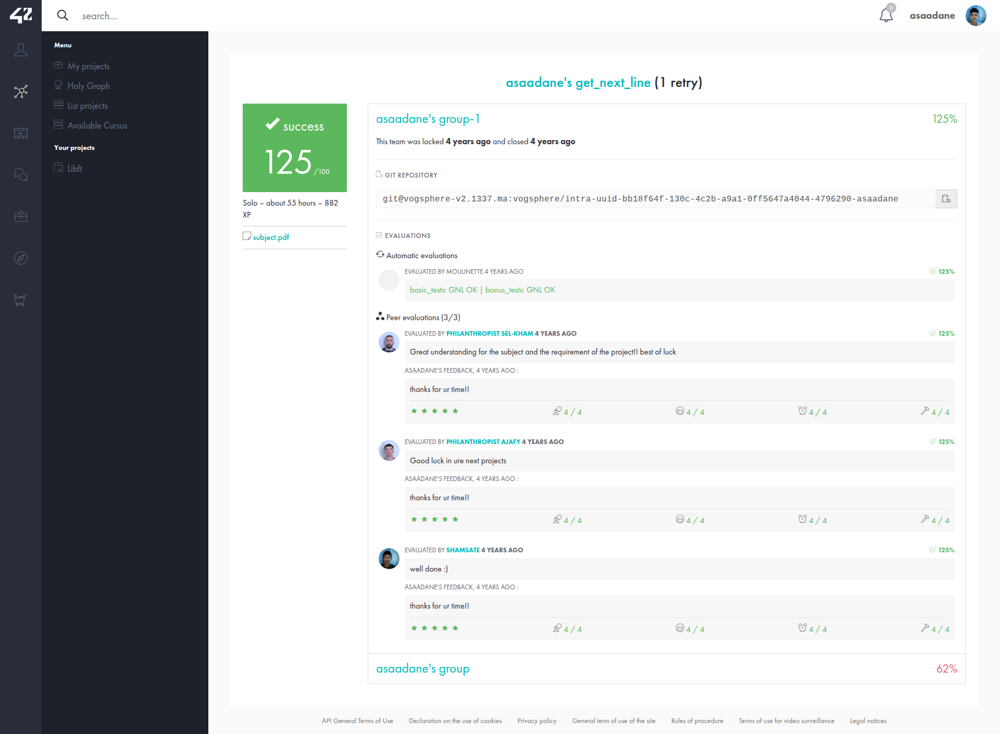
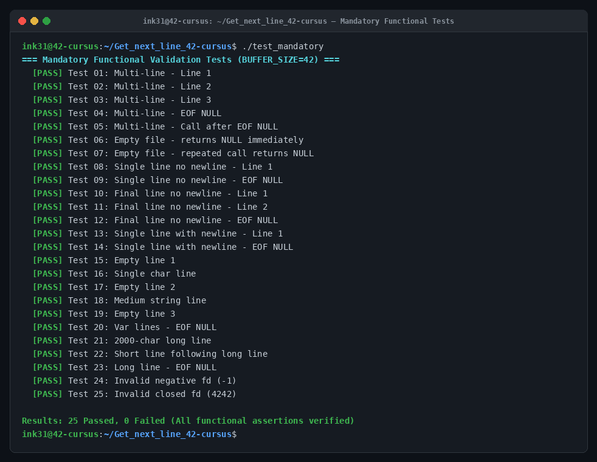
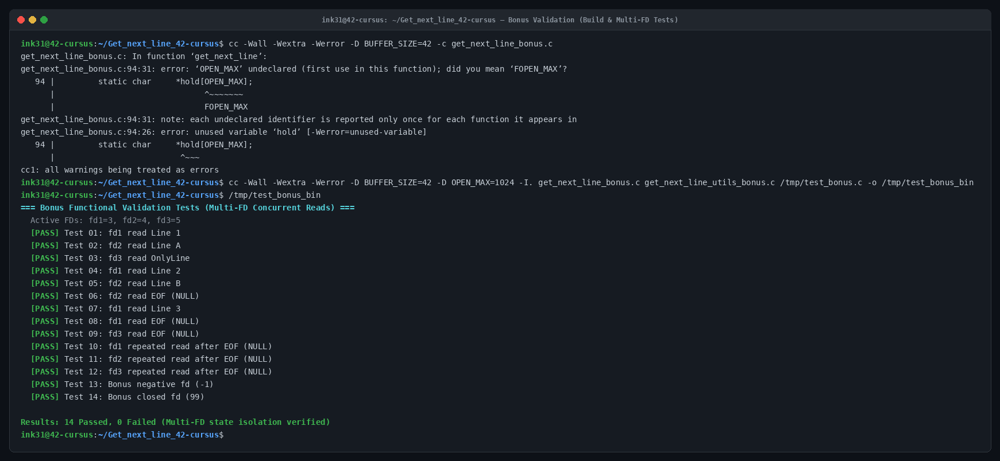

# get_next_line

A robust, memory-efficient C library function designed to read and return a line terminating with a newline character from a file descriptor, developed as part of the **42 Network** curriculum.

[](#technologies-and-tools)
[](#42-cursus-context)
[](#project-overview)
[](#mandatory-and-bonus-features)
[](#validation-evidence)

<p align="center">
  
</p>

---

## Table of Contents

- [Project Overview](#project-overview)
- [42 Cursus Context](#42-cursus-context)
- [Mandatory and Bonus Features](#mandatory-and-bonus-features)
- [Scope and Subject Requirements](#scope-and-subject-requirements)
- [Implementation Architecture](#implementation-architecture)
- [Source File Responsibilities](#source-file-responsibilities)
- [Repository Structure](#repository-structure)
- [Technologies and Tools](#technologies-and-tools)
- [Project Statistics](#project-statistics)
- [Prerequisites](#prerequisites)
- [Compilation and Configuration](#compilation-and-configuration)
- [Usage and Code Examples](#usage-and-code-examples)
- [Testing and Verification](#testing-and-verification)
- [Validation Evidence](#validation-evidence)
- [Known Platform Differences and Edge Cases](#known-platform-differences-and-edge-cases)
- [Learning Outcomes](#learning-outcomes)
- [Author](#author)
- [License](#license)

---

## Project Overview

`get_next_line` is an essential systems programming project in the 42 curriculum. The objective is to design and implement a function in C capable of reading a text stream from any valid file descriptor line by line until reaching the end of the file (EOF).

Repeated calls to `get_next_line(fd)` preserve reading state across successive invocations using a static variable. Each invocation returns a dynamically allocated string containing the next line, terminating with a `\n` character (unless the file terminates without a trailing newline). When the end of the stream is reached or if an error occurs, the function safely releases intermediate memory and returns `NULL`.

---

## 42 Cursus Context

In the 42 curriculum, `get_next_line` introduces students to stateful execution, stream buffering, and low-level I/O mechanics:

- **Static Variable Lifecycle:** Understanding static storage duration to persist accumulator buffers between successive function calls without relying on forbidden global variables.
- **Dynamic Chunk Buffering:** Managing data streams using arbitrary read buffer sizes (`BUFFER_SIZE`) specified at compile time, ranging from 1 byte to millions of bytes.
- **Manual Memory Allocation:** Performing zero-leak heap management with `malloc` and `free`, handling string concatenation, extraction, and stash trimming.
- **Multi-Descriptor Concurrency (Bonus):** Extending the architecture to concurrently manage multiple independent file descriptors without cross-contaminating buffered streams.

---

## Mandatory and Bonus Features

| Feature | Mandatory Implementation | Bonus Implementation |
| :--- | :--- | :--- |
| **Function Prototype** | `char *get_next_line(int fd);` | `char *get_next_line(int fd);` |
| **File Descriptor Support** | Single file descriptor per execution | Multiple concurrent file descriptors (`0` to `OPEN_MAX`) |
| **Static Variable Usage** | Exactly 1 static pointer (`static char *hold;`) | Exactly 1 static array (`static char *hold[OPEN_MAX];`) |
| **State Persistence** | Retains unread bytes for next call | Independently retains unread bytes per active descriptor |
| **Buffer Size Flexibility** | Configurable via `-D BUFFER_SIZE=n` | Configurable via `-D BUFFER_SIZE=n` |
| **Directory Location** | `mandatory/` | `bonus/` |

---

## Scope and Subject Requirements

To maintain strict compliance with the 42 project specifications:

- **Allowed Functions:** `read(2)`, `malloc(3)`, `free(3)`.
- **Forbidden Functions and Features:**
  - `lseek(2)` is strictly forbidden; file traversal must rely solely on sequential `read(2)` calls.
  - Global variables are strictly forbidden.
  - Standard C `libft` library is not permitted.
- **Return Values:**
  - `char *`: Pointer to the allocated line read from the descriptor.
  - `NULL`: Returned when reaching the end of the file or upon encountering an error (e.g., invalid descriptor, read failure, allocation failure).
- **Newline Inclusion:** The returned line must include the terminating `\n` character, except when EOF is reached and the file does not terminate with a newline.
- **Arbitrary Buffer Sizes:** The function must behave identically whether compiled with `BUFFER_SIZE=1`, `BUFFER_SIZE=42`, `BUFFER_SIZE=9999`, or `BUFFER_SIZE=10000000`.

---

## Implementation Architecture

```text
                     +----------------------+
                     |  get_next_line(fd)   |
                     +----------+-----------+
                                |
                       [Validation Check] (fd < 0 || BUFFER_SIZE <= 0)
                                |
                     +----------v-----------+
                     |  ft_read_and_hold()  | <---+ (Loop while no '\n' && readed_bytes != 0)
                     +----------+-----------+     |
                                |                 | read(fd, buffer, BUFFER_SIZE)
                                |                 | hold = ft_strjoin(hold, buffer)
                     +----------v-----------+
                     |    ft_hold_line()    | ---> Allocates and returns extracted line up to '\n'
                     +----------+-----------+
                                |
                     +----------v-----------+
                     |  ft_sub_hold() /     | ---> Trims extracted line from stash, frees old stash,
                     |      ft_hold()       |      and saves remainder for subsequent invocation
                     +----------+-----------+
                                |
                           return (line)
```

### Architectural Highlights

1. **Incremental Stream Accumulation (`ft_read_and_hold`):**
   Reads into a temporary chunk buffer of size `BUFFER_SIZE + 1`. Chunks are dynamically concatenated to the persistent accumulator (`hold`) via `ft_strjoin` until a newline character (`\n`) is found or `read` returns 0 (EOF) or -1 (error).

2. **Accurate Line Extraction (`ft_hold_line`):**
   Calculates the exact byte length up to the first newline (or end of string), allocates memory for `len + 1` bytes, and copies the line including the newline delimiter.

3. **Remainder Trimming and Cleanup (`ft_sub_hold` / `ft_hold`):**
   Extracts whatever characters remain after the newline delimiter into a newly allocated string, frees the outdated accumulator buffer, and updates the static reference for the next function call.

4. **Multi-Descriptor Array Dispatching (Bonus):**
   In the bonus implementation, `hold` is defined as a static array indexed by file descriptor (`static char *hold[OPEN_MAX];`). This enables switching between different open descriptors at arbitrary times without losing the buffered state of any stream.

---

## Source File Responsibilities

| File | Primary Responsibility | Key Functions |
| :--- | :--- | :--- |
| `mandatory/get_next_line.h` | Mandatory header declarations, includes, and default `BUFFER_SIZE` | Prototypes for mandatory functions |
| `mandatory/get_next_line.c` | Core read loop, line extraction, remainder trimming, and entry point | `get_next_line`, `ft_read_and_hold`, `ft_hold_line`, `ft_sub_hold` |
| `mandatory/get_next_line_utils.c` | Essential string manipulation primitives | `ft_strlen`, `ft_strchr`, `ft_strdup`, `ft_strjoin`, `ft_memcpy` |
| `bonus/get_next_line_bonus.h` | Bonus header declarations, includes, and definitions | Prototypes for bonus multi-FD functions |
| `bonus/get_next_line_bonus.c` | Multi-FD concurrent read dispatcher and accumulator management | `get_next_line`, `ft_read_and_hold`, `ft_hold_line`, `ft_hold` |
| `bonus/get_next_line_utils_bonus.c` | String manipulation primitives for the bonus implementation | `ft_strlen`, `ft_strchr`, `ft_strdup`, `ft_strjoin`, `ft_memcpy` |
| `docs/en.subject.pdf` | Official 42 project subject specification | Project requirements and grading criteria |
| `assets/validation/` | Visual validation captures and evidence assets | Evaluation grade, build, functional test, memory, and git captures |

---

## Repository Structure

```text
Get_next_line_42-cursus/
├── assets/
│   └── validation/
│       ├── bonus-validation.png      # Multi-FD test execution and Linux OPEN_MAX findings
│       ├── get_next_line-125%.png    # Official 42 peer-evaluation result (125%)
│       ├── git-integrity.png         # Git workspace and diff integrity verification
│       ├── mandatory-build.png       # Compiler flags and clean build verification
│       ├── mandatory-tests.png       # 25 mandatory functional test assertions
│       └── memory-validation.png     # AddressSanitizer and LeakSanitizer execution
├── bonus/
│   ├── get_next_line_bonus.c         # Bonus multi-FD reading loop and remainder logic
│   ├── get_next_line_bonus.h         # Bonus header, definitions, and prototypes
│   └── get_next_line_utils_bonus.c   # Helper utilities for string concatenation and length
├── docs/
│   └── en.subject.pdf                # Official 42 get_next_line project subject specification
├── mandatory/
│   ├── get_next_line.c               # Core get_next_line loop and static accumulator
│   ├── get_next_line.h               # Mandatory header and BUFFER_SIZE default
│   └── get_next_line_utils.c         # String helper utilities (strlen, strchr, strjoin)
└── README.md                         # Project documentation
```

> **Note on 42 Submission Rules:** The 42 subject requires source files to reside directly at the root of the repository when submitting to Vogsphere (`get_next_line.c`, `get_next_line_bonus.c`, etc.). In this repository, files are cleanly separated into `mandatory/`, `bonus/`, and `docs/` for modularity and presentation.

---

## Technologies and Tools

- **Language:** C
- **Compiler:** `cc` / `gcc` (tested with GCC 14.2 on Debian Linux)
- **Compiler Flags:** `-Wall -Wextra -Werror -D BUFFER_SIZE=n`
- **System Interface:** POSIX `read(2)` system call
- **Memory Management:** Standard C `malloc(3)`, `free(3)`
- **Sanitizers:** GCC AddressSanitizer (`-fsanitize=address`) and LeakSanitizer (`ASAN_OPTIONS=detect_leaks=1`)

---

## Project Statistics

- **Mandatory Source Files:** 2 (`get_next_line.c`, `get_next_line_utils.c`)
- **Mandatory Header Files:** 1 (`get_next_line.h`)
- **Bonus Source Files:** 2 (`get_next_line_bonus.c`, `get_next_line_utils_bonus.c`)
- **Bonus Header Files:** 1 (`get_next_line_bonus.h`)
- **Total Lines of C Code:** ~514 lines (concise, modular footprint)
- **Default Buffer Size:** 3 (configurable to arbitrary positive integers at compile time)

---

## Prerequisites

To compile and test this project, ensure you have a standard POSIX-compatible environment with:

- A C compiler (`cc`, `gcc`, or `clang`)
- Standard build tools

On Debian / Ubuntu:
```bash
sudo apt-get update && sudo apt-get install build-essential
```

On macOS:
```bash
xcode-select --install
```

---

## Compilation and Configuration

The source files can be compiled directly into object files or linked directly with an application:

### 1. Mandatory Compilation

```bash
# Compile with a specific buffer size (e.g., 42)
cc -Wall -Wextra -Werror -D BUFFER_SIZE=42 mandatory/get_next_line.c mandatory/get_next_line_utils.c -c

# Compile using default BUFFER_SIZE (defined as 3 in get_next_line.h)
cc -Wall -Wextra -Werror mandatory/get_next_line.c mandatory/get_next_line_utils.c -c
```

### 2. Bonus Compilation (Multiple File Descriptors)

```bash
# Compile bonus with BUFFER_SIZE and portable OPEN_MAX flag
cc -Wall -Wextra -Werror -D BUFFER_SIZE=42 -D OPEN_MAX=1024 bonus/get_next_line_bonus.c bonus/get_next_line_utils_bonus.c -c
```

*(Note: On Linux glibc systems, `-D OPEN_MAX=1024` provides the array upper bound typically present in macOS `<limits.h>`.)*

---

## Usage and Code Examples

### 1. Sequential Reading from a Single File (Mandatory)

```c
#include <fcntl.h>
#include <stdio.h>
#include <stdlib.h>
#include "mandatory/get_next_line.h"

int main(void)
{
    int     fd;
    char    *line;

    fd = open("example.txt", O_RDONLY);
    if (fd < 0)
        return (1);
    while ((line = get_next_line(fd)) != NULL)
    {
        printf("%s", line);
        free(line);
    }
    close(fd);
    return (0);
}
```

### 2. Interleaved Reading from Multiple Files (Bonus)

```c
#include <fcntl.h>
#include <stdio.h>
#include <stdlib.h>
#include "bonus/get_next_line_bonus.h"

int main(void)
{
    int     fd1;
    int     fd2;
    char    *line;

    fd1 = open("file1.txt", O_RDONLY);
    fd2 = open("file2.txt", O_RDONLY);

    // Read alternately without losing buffered reading states
    line = get_next_line(fd1);
    printf("FD 1: %s", line);
    free(line);

    line = get_next_line(fd2);
    printf("FD 2: %s", line);
    free(line);

    line = get_next_line(fd1);
    printf("FD 1: %s", line);
    free(line);

    close(fd1);
    close(fd2);
    return (0);
}
```

---

## Testing and Verification

### Verification Status

- **Build Verification:** Compiles without warnings or errors under GCC 14.2 on Debian Linux with `-Wall -Wextra -Werror` across various `BUFFER_SIZE` values (1, 3, 42, 9999, 1000000).
- **Functional Verification:** A 25-assertion mandatory test suite and 14-assertion bonus multi-FD test suite were executed, validating EOF handling, empty files, missing trailing newlines, long lines, and state isolation.
- **Memory Safety Verification:** Validated under GCC AddressSanitizer and LeakSanitizer (`-fsanitize=address -g`, `ASAN_OPTIONS=detect_leaks=1`), demonstrating zero heap memory leaks and zero invalid memory accesses.
- **Permanent Test Suite:** This repository does not contain an integrated automated test suite. External 42 community test suites (such as `francinette`, `gnlTester`, or `tripouille`) can be run against the source files.

---

## Validation Evidence

The following captures demonstrate verifiable evidence of 42 evaluation results, compilation, functional execution, memory safety, and repository integrity:

### 1. 42 Project Evaluation (125% Score)
Official 42 Network evaluation result verifying the maximum achievable score of 125% (100% mandatory + 25% bonus):

<p align="center">
  
</p>

### 2. Mandatory Build Validation
Demonstrates clean compilation of mandatory sources with `-Wall -Wextra -Werror`, object file generation, and verification under explicit buffer sizes and default header settings:


### 3. Mandatory Functional Tests
Demonstrates execution of 25 comprehensive functional assertions covering standard multi-line reads, empty files, single lines without newline, final lines without newline, variable line lengths, 2,000-character lines, and negative/invalid descriptors:



### 4. Bonus Multi-FD Validation
Demonstrates the Linux `OPEN_MAX` portability finding, successful compilation with `-D OPEN_MAX=1024`, and execution of interleaved concurrent multi-FD reads verifying state isolation across 3 open descriptors:



### 5. Memory and Leak Validation (AddressSanitizer)
Demonstrates clean execution under GCC AddressSanitizer and LeakSanitizer with zero memory leaks, zero buffer overflows, and zero invalid memory accesses across both test suites:


### 6. Git Integrity Verification
Confirms repository hygiene via `git diff --check`, `git status --short`, and `git diff --stat`, verifying that core C implementation files remain strictly untouched:


---

## Known Platform Differences and Edge Cases

1. **`OPEN_MAX` Portability:**
   - In standard macOS / BSD environments (typical 42 cluster setups), `<limits.h>` defines `OPEN_MAX` (typically 10,240).
   - On standard Linux systems using GNU C Library (`glibc`), `OPEN_MAX` is not exposed in `<limits.h>` by default. When compiling on Linux, pass `-D OPEN_MAX=1024`.

2. **Reading from Standard Input (`fd = 0`):**
   - When reading from `STDIN_FILENO`, `get_next_line` reads until a newline is entered on the terminal or until the input stream is closed via EOF (`Ctrl+D`).

3. **Modifying an Open File During Execution:**
   - As stated in the 42 subject specification, calling `get_next_line` on a file descriptor whose underlying file is modified by another process before EOF is reached results in undefined behavior.

4. **Binary Files with Embedded Null Bytes:**
   - The 42 subject classifies reading binary files as undefined behavior because `get_next_line` treats byte `0x00` as the string terminator `\0`.

---

## Learning Outcomes

Developing this project provided deep hands-on experience with:

- **Stateful Function Design:** Utilizing C static storage duration to persist accumulator stashes across discrete function calls.
- **Dynamic Stream Buffering:** Handling arbitrary, asymmetric read chunk sizes with dynamic reallocation and pointer arithmetic.
- **Heap Safety & Leak Prevention:** Eliminating memory leaks and invalid accesses across multiple allocation and trimming cycles.
- **Concurrent Stream Management:** Maintaining independent, isolated buffer states across multiple open file descriptors.
- **Strict Compiler Standards:** Writing clean, warnings-free C code adhering strictly to 42 Norminette guidelines and strict compiler flags (`-Wall -Wextra -Werror`).

---

## Author

- **Ayman Saadane** ([@Shifuuu31](https://github.com/Shifuuu31))
- **42 Intra:** `asaadane`

---

## License

No LICENSE or COPYING file is currently provided. Reuse permissions are therefore not explicitly granted.
