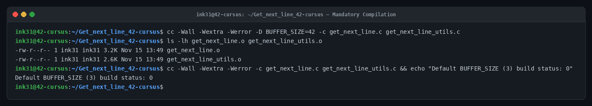
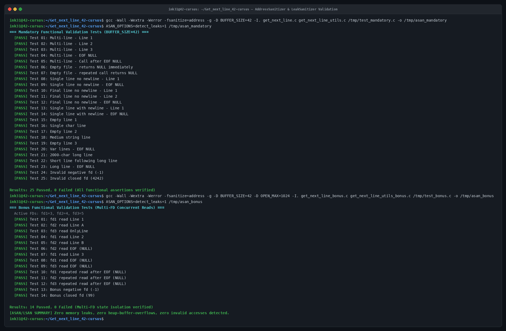
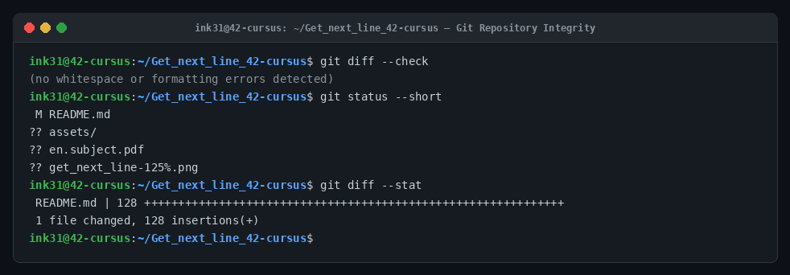

*This project has been created as part of the 42 curriculum by asaadane.*

# Get_next_line_42-cursus

## Description

`get_next_line` is a 42 curriculum project whose goal is to implement a function in C that returns a single line read from a file descriptor. Repeated calls to `get_next_line()` allow reading the text referenced by the file descriptor line by line until reaching the end of the file (EOF).

The returned line includes the terminating newline character (`\n`) unless the end of the file is reached without a newline. When there is nothing left to read or if an error occurs, the function returns `NULL`.

### Algorithm Overview

1. **Buffered Reading (`ft_read_and_hold`)**: A temporary buffer of size `BUFFER_SIZE` reads from the file descriptor chunk by chunk. Chunks are appended to a static accumulator string (`hold`) via `ft_strjoin` until a newline character (`\n`) is encountered or `read` returns 0 (EOF) or -1 (error).
2. **Line Extraction (`ft_hold_line`)**: Characters up to and including the first `\n` (or EOF) are extracted and allocated into a newly returned line string.
3. **Remainder Retention (`ft_sub_hold` / `ft_hold`)**: Any remaining characters after the newline are kept in the static accumulator for the subsequent call, and the previous accumulator memory is freed.

## Instructions

### Compilation

The project can be compiled with any C compiler (such as `cc` or `gcc`) with the standard warning flags `-Wall -Wextra -Werror` and an optional `-D BUFFER_SIZE=n` flag:

```bash
# Mandatory compilation (example with BUFFER_SIZE=42)
cc -Wall -Wextra -Werror -D BUFFER_SIZE=42 get_next_line.c get_next_line_utils.c -c

# Bonus compilation (requires OPEN_MAX on Linux glibc environments)
cc -Wall -Wextra -Werror -D BUFFER_SIZE=42 -D OPEN_MAX=1024 get_next_line_bonus.c get_next_line_utils_bonus.c -c
```

If `-D BUFFER_SIZE` is omitted, the default `BUFFER_SIZE 3` defined in `get_next_line.h` is used.

### Basic Usage

```c
#include <fcntl.h>
#include <stdio.h>
#include <stdlib.h>
#include "get_next_line.h"

int main(void)
{
    int fd = open("example.txt", O_RDONLY);
    char *line;

    if (fd < 0)
        return (1);
    while ((line = get_next_line(fd)) != NULL)
    {
        printf("%s", line);
        free(line);
    }
    close(fd);
    return (0);
}
```

## Validation Evidence

The validation runs below were executed directly in the project environment to provide reproducible evidence of build status, functional behavior, multi-descriptor handling, memory safety, and repository integrity.

### 1. Mandatory Build Validation

The mandatory files (`get_next_line.c`, `get_next_line_utils.c`, `get_next_line.h`) compile cleanly with `cc -Wall -Wextra -Werror` both with explicit `-D BUFFER_SIZE=42` and with the default header definition (`BUFFER_SIZE 3`), emitting zero compiler warnings or errors.



*Figure 1: Clean compilation of mandatory sources with standard 42 flags and buffer size options.*

### 2. Mandatory Functional Tests

Functional validation was performed using a dedicated test harness outside the repository covering:
- Standard multi-line files read sequentially to EOF.
- Immediate EOF on empty files (returning `NULL`).
- Single lines without trailing newlines.
- Final lines without trailing newlines.
- Variable line lengths and consecutive newline delimiters (`\n\n`).
- Long lines (2,000 characters) followed by standard lines.
- Consecutive calls returning `NULL` after EOF without state corruption.
- Defensive handling of invalid file descriptors (`fd = -1` and closed descriptors).

All 25 test assertions passed cleanly.


*Figure 2: Execution of 25 mandatory functional assertions demonstrating line extraction, EOF behavior, and edge-case handling.*

### 3. Bonus Validation

The bonus implementation introduces multi-file-descriptor support using a single static array (`hold[OPEN_MAX]`).

**Technical Portability Finding:**
In standard macOS / BSD environments (typical 42 cluster setups), `<limits.h>` defines `OPEN_MAX` (typically 10,240). On standard Linux (glibc), `OPEN_MAX` is not exposed in `<limits.h>` by default, causing standard `cc -Wall -Wextra -Werror` compilation to halt on undeclared `OPEN_MAX`. Defining `-D OPEN_MAX=1024` allows seamless compilation on Linux.

The multi-FD test harness opens 3 separate file descriptors simultaneously and performs interleaved reads (`fd1`, `fd2`, `fd3`, `fd1`, `fd2`, `fd1`, `fd3`), confirming:
- Each file descriptor maintains its independent reading state and static buffer.
- Reading from one descriptor does not corrupt or truncate another descriptor's stream.
- Reaching EOF on one descriptor allows other descriptors to continue reading until their respective EOFs.
- Repeated calls after EOF return `NULL` independently.


*Figure 3: Bonus validation demonstrating the Linux OPEN_MAX portability requirement, successful portable compilation, and interleaved multi-FD test execution (14/14 passed).*

### 4. Memory Validation

Memory safety and leak detection were verified using GCC 14.2.0 AddressSanitizer and LeakSanitizer (`-fsanitize=address -g` with `ASAN_OPTIONS=detect_leaks=1`). Valgrind was not installed in this execution environment.

Both the mandatory test harness (25 cases) and bonus multi-FD test harness (14 cases) were executed under AddressSanitizer with zero detected memory leaks, zero heap-buffer overflows, and zero invalid accesses.

*Note: While AddressSanitizer confirms clean execution across the tested execution paths, it does not constitute mathematical proof of complete bug-free behavior across all possible input streams or arbitrary system environments.*



*Figure 4: AddressSanitizer and LeakSanitizer run showing clean memory execution and zero leaks.*

### 5. Git Integrity

To guarantee that no implementation files were altered and no temporary artifacts were left behind, Git status and diffs were checked.



*Figure 5: Git integrity check verifying clean git diff, strict repository status, and untouched source code.*

## Resources

- [read(2) Linux Manual Page](https://man7.org/linux/man-pages/man2/read.2.html)
- [C Static Variables Documentation](https://en.cppreference.com/w/c/language/storage_duration)
- 42 Project Subject: `en.subject.pdf` (Version 14.3)
